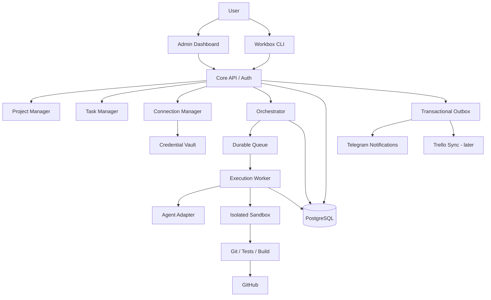
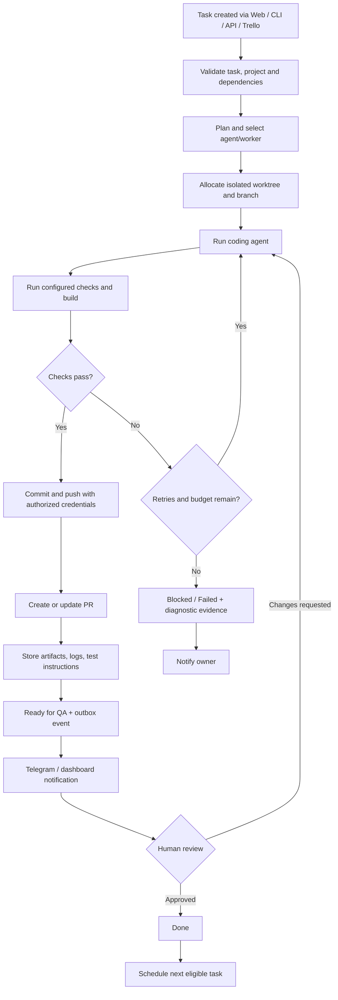
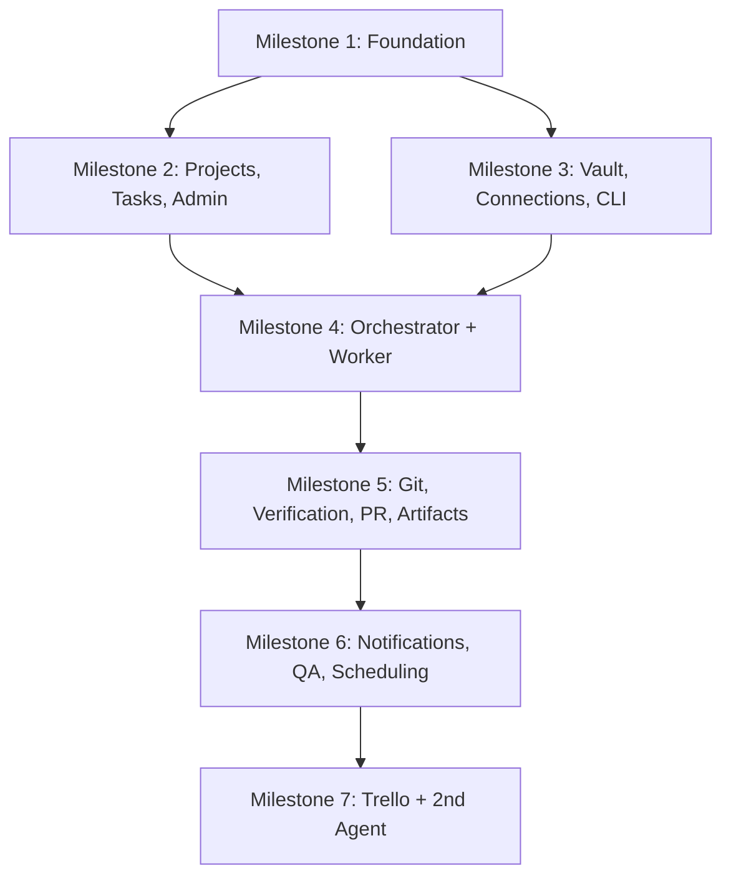

# Workbox — AI-Agnostic Autonomous Development Platform

> **Project specification and implementation handoff**  
> Version: 0.1 (planning baseline)  
> Updated: 2026-11-04  
> Status: Proposed architecture; **not** an implementation or a claim that any component exists.

## 1. Executive Summary

**Workbox** is an AI-native, provider-agnostic software development orchestration platform. A user describes a software idea, connects an existing repository or creates a new one, and delegates tasks to coding agents. Workbox plans and schedules tasks, provisions isolated execution environments, runs agents, verifies changes, creates Git branches/commits/pull requests, stores artifacts, updates task statuses, and notifies the user. A web administration dashboard and a CLI expose the same backend capabilities.

Workbox is **not** intended to be another LLM chat wrapper or a single proprietary coding agent. It is a **control plane** coordinating multiple interchangeable model providers and coding-agent runtimes, with explicit approval gates and observable, auditable execution.

### Primary user stories

1. **Start from scratch:** Describe a project; Workbox creates its project record, proposes a technical plan, optionally provisions a Git repository, and executes approved tasks.
2. **Continue an existing project:** Connect a Git repository, inspect its structure and conventions, and implement a requested change in a separate branch/worktree.
3. **Delegate a backlog:** Enter tasks through the dashboard, CLI, API, or an external board; Workbox selects the next eligible task, runs it, and advances it to QA.
4. **Review results:** Inspect test/build results, changed files, commits, PR status, artifacts, and step-by-step manual test instructions.
5. **Receive notifications:** Get Telegram messages for ready-for-QA, blocked tasks, failed builds, and important milestones; see delivery status in the dashboard.
6. **Connect tools:** Configure GitHub, model providers, agent CLIs, Telegram, Trello, and future integrations from either CLI or admin UI.
7. **Retain control:** Pause/cancel/retry executions, approve/reject deliverables, rotate credentials, limit spending, and inspect activity history.

## 2. Product Principles

- **Provider-agnostic, not capability-identical:** Standardize contracts while explicitly representing differences in tool support, session handling, pricing, and execution capabilities.
- **One backend, multiple interfaces:** CLI, dashboard, API, and future chat/voice interfaces call the same domain services.
- **Human-in-the-loop by default:** No automatic merge to the protected default branch or production deployment without explicit configured authorization.
- **Secure execution:** Treat repository content, agent output, and third-party tool results as untrusted. Restrict filesystem, network, secrets, and command execution.
- **Durable workflows:** Record every state transition and external operation; recover safely after crashes and retries.
- **Evidence over claims:** Distinguish generated code, passing tests, successful builds, deployed previews, and human acceptance.
- **Start simple:** Modular monolith plus independent worker; avoid premature microservices.
- **Self-hostable first:** Local development with an architecture capable of supporting remote workers later.

## 3. Scope

### MVP (v0.1–v0.2)

- Project registration and repository linking (existing repository first; new repository provisioning subsequently).
- Task creation, prioritization, status tracking, and history.
- Minimal dashboard: projects, task cards, task details, connections, activity.
- CLI with equivalent core actions.
- Encrypted credential storage and provider connection testing.
- One working coding-agent adapter (recommended initial candidate: Codex CLI; verify licensing and automation suitability).
- Isolated worker, task queue, Git worktree/branch, agent execution, test/build commands.
- Commit/push/PR creation where authorized; persist PR, branch, and commit references.
- Test/build logs and artifact metadata; manual QA instructions.
- Telegram notification delivery tracking.
- Human approval/rejection and bounded retries.

### Later releases

- Second coding-agent adapter (e.g. Claude Code) to prove interchangeability.
- Direct LLM tool-calling agent runtime (OpenAI/Anthropic/Gemini/Ollama adapters).
- Trello two-way synchronization with conflict handling.
- Voice-to-task transcription, autonomous planning, dependency-aware backlog scheduling.
- Multiple workers, remote execution, cost-aware routing, parallel agents, advanced memory, preview deployments, multi-user organizations, SaaS billing.

### Explicit non-goals for first release

- Fully autonomous production deployment.
- Perfect interchangeability between models or agent CLIs.
- Running arbitrary untrusted repositories with unrestricted host access.
- Multi-tenant hosted infrastructure or sophisticated billing.
- Automatically proving semantic correctness solely from tests.

## 4. High-Level Architecture



**Implementation nuance:** The diagram represents logical relationships, not direct database writes from every module. Domain services own persistence boundaries. A transactional outbox and idempotent consumers handle reliable external side effects.

### Recommended technology stack

| Area | Recommended baseline | Notes |
|---|---|---|
| Language | TypeScript / Node.js | ESM; strict types |
| API | Fastify | OpenAPI schema and validation |
| Web | React + Vite | Small admin UI initially |
| Database | PostgreSQL | Durable source of truth |
| DB access | Drizzle or Knex | Choose one in ADR-001 |
| Queue | BullMQ + Redis | At-least-once execution; idempotency required |
| Execution | Docker-based worker | Rootless/restricted where feasible |
| Git | Git CLI + GitHub API | Provider adapter for future GitLab |
| Live updates | SSE | WebSocket only if necessary |
| Notifications | Telegram Bot API | Outbox + retry + delivery records |
| Integrations | Native adapters; MCP optional | MCP is a tool protocol, not a security boundary |
| Local deployment | Docker Compose | Remote workers as later extension |
| CI | GitHub Actions | Lint, unit, integration, build |

### Proposed monorepo layout

```text
workbox/
  apps/
    api/                 # Fastify REST API
    web/                 # React admin dashboard
    worker/              # Queue consumer and sandbox controller
    cli/                 # Workbox CLI client
  packages/
    core/                # Domain types, policies, state machines
    database/            # Schema, migrations, repositories
    orchestrator/        # Scheduling and workflow execution
    agent-adapters/      # Agent runtime interfaces and adapters
    integrations/        # GitHub, Telegram, Trello, etc.
    vault/               # Credential encryption and access policy
    sandbox/             # Container lifecycle and command execution
    shared/              # DTOs, validation schemas, API contracts
  docs/
    adr/                 # Architecture decision records
    operations/          # Local setup, recovery, deployment
  infra/
    docker/
  compose.yaml
  .env.example           # No real secrets
  README.md
  WORKBOX_PROJECT_SPEC.md
```

## 5. Core Domain Model

**Entities (minimum viable fields; add standard timestamps and IDs):**

| Entity | Key fields / responsibilities |
|---|---|
| `projects` | name, slug, repo URL, default branch, configuration, lifecycle status |
| `tasks` | project_id, title, description, acceptance criteria, priority, state, dependencies |
| `task_runs` | task_id, agent_profile_id, worker_id, state, attempt, start/end, exit reason, cost |
| `agent_profiles` | adapter type, provider, model/runtime settings, capabilities, budgets |
| `workers` | identity, execution capabilities, health, availability, local/remote location |
| `git_references` | task_id/run_id, branch, commit SHA, PR URL/number, draft/open/merged/closed status |
| `artifacts` | run_id, type, storage URI, checksum, metadata, retention |
| `credentials` | provider, auth type, encrypted payload, key version, metadata |
| `connections` | provider, credential reference, non-secret config, status, last health check |
| `project_connections` | project_id, connection_id, permission scope |
| `notifications` | event_id, channel, destination, state, attempts, provider message ID, error |
| `outbox_events` | event type, aggregate ID, payload, creation and processing state |
| `audit_logs` | actor, action, resource, timestamp, safe metadata |

Use foreign keys, uniqueness constraints, migration files, and explicit indexes. Never place raw secrets in audit logs, event payloads, task prompts, or artifact metadata.

### Distinct state machines

- **Task:** `backlog → planning → in_progress → verification → ready_for_qa → done`; side paths: `blocked`, `cancelled`, `changes_requested`.
- **Run:** `queued → preparing → running → verifying → completed`; terminal alternatives: `failed`, `cancelled`, `timed_out`.
- **PR:** `draft`, `open`, `merged`, `closed` (reflect upstream provider state).
- **Verification:** `pending`, `running`, `passed`, `failed`, `skipped`.
- **Notification:** `pending`, `sending`, `sent`, `retry_scheduled`, `failed`.
- **Connection:** `unconfigured`, `connected`, `degraded`, `expired`, `disconnected`.

**Do not collapse these into one status.** Example: a task can be `ready_for_qa` while its PR remains `draft` and a Telegram notification is `retry_scheduled`.

## 6. Task Execution Workflow



### Required execution guarantees

- One active writer per branch/worktree by default; prevent conflicting tasks with locks.
- Use unique run IDs and idempotency keys for retries and GitHub operations.
- Queue delivery is **at least once**, not exactly once; all external actions must tolerate duplicates.
- Bounded retry count, execution time, token spend, and container resources.
- Persist checkpoints and operation results; recover/reconcile after worker crashes.
- Separate **agent-reported completion** from **verification passed** and **human accepted**.
- Persist exit codes, command outputs (redacted), test summaries, PR links, and artifact checksums.
- Permit cancel, pause where supported, retry, and request-changes through the same API.

## 7. Agent and Model Abstraction

**Two separate integration layers:**

1. **Model Provider Adapter:** Calls model APIs (OpenAI, Anthropic, Gemini, Ollama, etc.). A model alone does not execute shell commands or edit files; Workbox must supply the tools and agent loop.
2. **Coding Agent Runtime Adapter:** Supervises an existing agent process (e.g. Codex CLI, Claude Code), respecting its supported headless mode, authentication, approvals, structured output, and licensing.

Suggested conceptual interfaces (illustrative, subject to implementation design):

```ts
type AgentCapability =
  | 'code_edit'
  | 'shell'
  | 'stream_events'
  | 'resume_session'
  | 'structured_output';

interface AgentTask {
  runId: string;
  workspacePath: string;
  instructions: string;
  allowedTools: string[];
  timeoutMs: number;
  budgetUsd?: number;
}

interface AgentResult {
  status: 'completed' | 'failed' | 'blocked' | 'cancelled';
  summary: string;
  changedFiles: string[];
  artifacts: Array<{ type: string; path: string }>;
  usage?: { inputTokens?: number; outputTokens?: number; costUsd?: number };
}

interface AgentAdapter {
  id: string;
  capabilities(): Promise<AgentCapability[]>;
  execute(task: AgentTask, emit: (event: AgentEvent) => void): Promise<AgentResult>;
  cancel(runId: string): Promise<void>;
}

type AgentEvent = {
  runId: string;
  type: 'started' | 'progress' | 'tool_call' | 'log' | 'completed' | 'failed';
  timestamp: string;
  payload: Record<string, unknown>;
};
```

Actual interfaces should use typed discriminated unions, validation, cancellation signals, durable event persistence, and explicit security policies. Avoid forcing adapters to claim unsupported features. Implement at least two adapters before asserting meaningful provider independence.

## 8. Connection Manager and Credential Vault

### Requirements

- Unified catalog of supported integrations and authentication methods.
- Connect, list, test, disconnect, rotate, and inspect status through **both CLI and dashboard**.
- Support API keys, personal access tokens, OAuth/app authorization where available, and worker-local CLI sessions.
- Credentials can be reused across projects with explicit project-scoped authorization.
- Store secrets encrypted at rest; never return plaintext to frontend after submission.
- Keep master encryption key **outside the database** (environment secret or OS secret store for local deployment; KMS/Vault for production).
- Rotate encryption keys with `key_version`, authenticated encryption (e.g. AES-256-GCM), access auditing, and redaction.
- Use minimum provider scopes and separate read-only vs write capabilities.
- Validate connections with safe test operations and expose last-check result.

**Critical distinction:** An authenticated local agent CLI is a **worker capability**, not automatically a transferable API credential. Do not copy or extract CLI tokens into Workbox. A remote worker must be authenticated independently through supported methods.

### Example CLI contract

```bash
workbox project create "Example"
workbox project connect --repo https://github.com/org/repo
workbox task create --project example --title "Add health endpoint"
workbox task list --project example
workbox task run TASK_ID
workbox task status TASK_ID
workbox task approve TASK_ID
workbox connection add github
workbox connection add openai
workbox connection list
workbox connection test github
workbox connection remove github
workbox worker list
```

Commands above are **planned**, not implemented. Prefer interactive secure input, browser OAuth where supported, and secret references; avoid tokens as command-line arguments, shell history, or printed output.

### Dashboard connection flow

`Integrations → Select provider → Select supported auth method → Authorize/enter secret → Verify connection → Assign to projects → Save → Show health/status`.

## 9. Admin Dashboard Specification

### Initial screens

1. **Overview:** project count, task counts by state, active runs, ready-for-QA queue, recent failures.
2. **Projects:** list, create/connect repo, repository details, configured connections, default agent.
3. **Tasks:** cards/table with title, project, task status, latest run, assigned agent, Git branch, last commit, PR number/URL/status, verification status, Telegram delivery status.
4. **Task Detail:** acceptance criteria, run timeline, logs, test/build output, artifacts, PR links, QA instructions, approve/request changes/retry/cancel controls.
5. **Connections:** provider catalog, connection status, auth method, test/rotate/disconnect actions; no secret reveal.
6. **Activity:** audit and event timeline with filters.

### Status behavior

- Display Git branch, commit SHA, PR draft/open/merged/closed, and latest upstream check time separately.
- Display Telegram `pending/sent/failed/retry_scheduled` and attempts; a task can succeed even if a notification fails.
- Display task status and run status separately.
- Allow manual task actions only when valid in the state machine; enforce authorization in backend.
- Prefer polling or SSE initially; show last-updated timestamp and loading/error states.

## 10. Integrations

### GitHub

- Use least-privilege app or token authentication.
- Read repo metadata, clone/fetch, create branch, commit/push, create/update PR, inspect PR status.
- Never force-push or merge by default.
- Reconcile PR statuses periodically or via verified webhooks.
- Avoid embedding credentials in Git remotes, logs, or generated code.

### Telegram

- Bot token stored in vault; recipient/chat ID stored as connection config.
- Events: task ready for QA, blocked, run failed, build failed, release candidate ready.
- Persist notification state, attempts, timestamps, provider response ID, and last error.
- Retry transient errors with backoff; rate limit; deduplicate by event and recipient.
- Interactive approval buttons only after signed/verified callback handling and access control.

### Trello (post-MVP)

- Map Trello cards to Workbox tasks with stable external IDs.
- Workbox remains authoritative for execution state; map external board columns to workflow states.
- Handle duplicate webhooks, manual card moves, concurrent edits, and sync loops.
- Sync task description, status, PR URL, and review notes; never copy secrets.

### MCP and extensibility

- An integration adapter contract should expose discovery, auth requirements, capabilities, health, and permitted operations.
- MCP can be supported for tool access, but tools must still pass through Workbox policy checks, allowlists, audit logs, and sandbox boundaries.

## 11. Security and Operational Requirements

- Authenticate all non-local API/dashboard requests; use authorization and project-level access checks.
- Restrict CORS, protect session cookies/CSRF where applicable, and rate-limit sensitive endpoints.
- Run untrusted code in disposable containers with resource/time limits, non-root users, restricted network egress, no Docker socket mount, and minimal mounts.
- Never expose vault master keys or broad GitHub credentials to arbitrary agent shell commands; use scoped brokered operations or short-lived credentials where possible.
- Treat repository README/comments and external tool output as untrusted input; defend against prompt injection.
- Audit every credential access, approval, merge/deploy action, and destructive operation.
- Define retention/redaction for prompts, logs, artifacts, and personal data.
- Provide backup/restore and migrations; document recovery after queue/worker failure.
- Use health endpoints, structured logs, trace IDs, and metrics for task durations/failures/costs.

## 12. Implementation Roadmap and Dependencies



### M1 — Foundation

**Deliver:** TypeScript monorepo; Fastify API; PostgreSQL migrations; Redis/BullMQ bootstrap; Docker Compose; shared DTOs; health endpoint; CI lint/typecheck/test/build; `.env.example`; setup README; first architecture decision records.

**Acceptance:** `docker compose up -d` starts infrastructure; API `/health` works; migrations apply from empty DB; CI passes; no secrets committed.

### M2 — Projects, Tasks, Minimal Admin

**Deliver:** Project CRUD, repository metadata, Task CRUD, state machine with audit events, React dashboard showing task cards/statuses and project detail, task detail skeleton.

**Acceptance:** Create project/task via API; view/edit task in dashboard; invalid transitions rejected; status history persisted.

### M3 — Credential Vault, Connection Manager, CLI

**Deliver:** Encrypted credential persistence, provider catalog, connection health checks, GitHub + first agent auth integration, CLI commands calling API, UI connection form.

**Acceptance:** Add/test/revoke a connection from CLI and dashboard; no plaintext secret returned or logged; connection scoped to project.

### M4 — Orchestrator and Isolated Execution

**Deliver:** AgentAdapter interface, one working coding-agent adapter, queue consumer, worker registration, sandbox/worktree lifecycle, task run events, bounded retries/cancellation.

**Acceptance:** Agent executes a safe task in a test repository; logs and run state are persisted; timeout/cancel/retry behavior tested.

### M5 — Git Workflow and Verification

**Deliver:** GitHub branch/commit/push/PR operations, configured lint/test/build steps, test summary, artifact storage, QA instructions, dashboard Git references.

**Acceptance:** From a task, create a branch, implement change, pass checks, open PR, and display PR/commit/artifact links. Failures are visible and do not report false success.

### M6 — Notifications and Human QA

**Deliver:** Transactional outbox, Telegram delivery/retry tracking, dashboard notification status, approve/request changes, next-task scheduling with dependency checks.

**Acceptance:** Successful verified task becomes `ready_for_qa`; Telegram message delivery is recorded; human review drives the next valid state transition.

### M7 — Interoperability Proof and External Boards

**Deliver:** Second agent adapter; same task executed with different adapters in test fixtures; Trello card mapping and two-way sync; reconciliation jobs.

**Acceptance:** Switch agent profile without changing task domain model; Trello updates are idempotent; conflicting updates have deterministic handling.

## 13. Suggested First Vertical Slice

After M1, avoid implementing every screen in isolation. Build one narrow end-to-end scenario:

1. Register an existing **non-sensitive test repository**.
2. Create task: “Add a `/health` endpoint and a unit test.”
3. Execute with a single coding-agent adapter in an isolated worker.
4. Run tests, commit changes to a new branch, and open a draft PR.
5. Persist branch, commit SHA, PR, run logs, and test results.
6. Show everything on the task detail screen.
7. Send a Telegram notification and record its delivery status.
8. Approve or request changes; verify transitions and retry behavior.

This scenario demonstrates the core value proposition before advanced planning, multi-agent collaboration, or Trello synchronization.

## 14. Quality Strategy

- **Unit tests:** state machines, scheduling policies, permission checks, adapter normalization, notification retry logic.
- **Integration tests:** PostgreSQL migrations/constraints, queue + outbox processing, credential encryption/decryption, GitHub adapter against mocks/test repo.
- **End-to-end tests:** dashboard → API → queue → worker → branch → verification → PR → notification → QA.
- **Failure injection:** worker killed mid-run, duplicate queue delivery, GitHub rate limit, expired token, failed Telegram send, test failures, agent timeout.
- **Security tests:** secret redaction, unauthorized connection access, malicious repo instructions, blocked host mounts/network access.
- **Adapter conformance suite:** standard fixtures and expected normalized events/results for every supported coding-agent adapter.

## 15. Architecture Decisions to Record

- **ADR-001:** Drizzle vs Knex; migrations and schema ownership.
- **ADR-002:** CLI/API authentication model for local and remote deployments.
- **ADR-003:** Vault encryption and master key lifecycle.
- **ADR-004:** Container isolation and secret brokering.
- **ADR-005:** Task/run state machine and event/outbox guarantees.
- **ADR-006:** Agent adapter contract, streaming, and session continuation.
- **ADR-007:** Git worktree and concurrency strategy.
- **ADR-008:** Local vs remote worker identity and trust.

## 16. Guidance for Any AI Coding Provider

The following instructions are intended to be copied into a Codex, Claude Code, Cursor, or other coding-agent session together with this file.

> You are implementing **Workbox**, an AI-agnostic autonomous software development orchestration platform. Read `WORKBOX_PROJECT_SPEC.md` in full before making changes. Inspect the current repository, its docs, package manifests, and existing implementation; do not assume the specification has already been implemented. Report the actual current state and identify the smallest next milestone. Follow existing project conventions unless there is a documented reason to change them. Preserve provider neutrality and keep CLI/dashboard logic behind shared backend services. Do not commit secrets, bypass tests, auto-merge into the default branch, or deploy to production without explicit authorization. Implement changes on a feature branch, include migrations/tests/docs where needed, run relevant checks, and report exact results, failures, files changed, and manual validation steps. Do not claim success without evidence. Ask for approval before irreversible or privileged operations. Update project progress documentation after each completed milestone.

### Suggested first prompt

> Read `WORKBOX_PROJECT_SPEC.md`. Audit this repository and tell me what already exists versus what remains for M1. Produce a concise implementation plan and proposed file tree. Then implement **Milestone 1 only**, including a reproducible local setup, migrations, health endpoint, and CI checks. Run the available tests/build and report results. Do not start M2 until I approve.

### Suggested follow-up prompt

> Read the current `WORKBOX_PROJECT_SPEC.md`, existing code, ADRs, and milestone progress. Identify the next incomplete acceptance criterion, implement the smallest coherent change on a feature branch, test it, and provide a PR-ready summary with exact verification evidence. Preserve the documented interfaces and update the progress log.

## 17. Project Progress Template

Create and maintain `docs/PROGRESS.md`:

```markdown
# Workbox Progress

## Current milestone
M1 — Foundation

## Completed
- [ ] Monorepo initialized
- [ ] Docker Compose infrastructure
- [ ] Database migrations
- [ ] API health endpoint
- [ ] CI pipeline

## In progress
- None

## Blocked
- None

## Decisions
- ADR links here

## Verification
- Commands executed and actual results

## Next action
- One concrete task and acceptance criterion
```

## 18. Open Questions / Defaults

These decisions are **proposed defaults**, not user-approved requirements:

- **Deployment:** Hybrid-ready architecture; start with a local Docker Compose environment.
- **First agent:** Codex CLI as a candidate; validate automation APIs and authentication constraints before committing.
- **Repository:** New GitHub repository for Workbox; use an existing disposable repo as the initial execution fixture.
- **UI:** Minimal React dashboard, not a polished design system initially.
- **Git policy:** Draft PR and human approval by default; no automatic merge or production deployment.
- **Secrets:** Local encrypted vault initially; external secret manager for hosted deployments.
- **Trello:** Defer until the native task model and reliable event flow work.

## 19. Definition of Project Success

Workbox reaches its first meaningful product milestone when a user can connect a repository, create a task from the dashboard or CLI, have a coding agent safely implement it, automatically run verification, receive a linked branch/PR and clear manual testing instructions, inspect all statuses and notification outcomes in the dashboard, and approve or reject the result — **without manually orchestrating the agent's intermediate steps**.

---

**Document ownership:** Product/engineering planning baseline. Revise it through versioned changes and ADRs as the implementation evolves. This document is intentionally provider-neutral and may be used as the source of truth across multiple AI coding tools.
